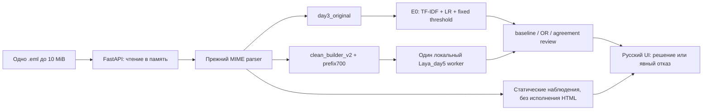

# Примечание о публикации

Для CPU-демо подготовлена отдельная адаптация Render: PUBLISH_STEPS.md и DEPLOYMENT_CHANGES.md. Реальный статус публикации добавляется только после успешных проверок URL и перезапуска. Указанные ниже Windows- и Docker-результаты относятся к исходному комплекту.

# Передача проекта для презентации и защиты

## Главная мысль

Email Guard решает бинарную задачу spam/ham для загруженного `.eml`, сравнивая простой воспроизводимый baseline с более сложными подходами. Проект показывает весь путь: инвентаризация и метки → нормализация/группы → CV/validation → ограниченная адаптация и calibration → заранее зафиксированная финальная оценка → безопасный локальный inference и комплект запуска.

Показывать качество и ограничения вместе. Не называть систему универсальной защитой от фишинга, не выдавать ham за безопасность, а OR за независимо выбранного победителя.

## Последовательность слайдов

1. **Проблема.** Нежелательные письма, цена ложной тревоги и пропуска. Spam, реклама, phishing и категория — разные понятия; согласие пользователя может отсутствовать во входе.
2. **Данные.** SpamAssassin/Ling-Spam — historical English; RU auxiliary — text-only provisional; Nazario/modern источники имеют отдельные роли. Сырые письма не публикуются. Исторический split5953/1275/1276 и RU27953/5990/5990.
3. **Утечки.** Группы exact/canonical/near до split, приоритет test > validation > train; source/path/labels исключены из model text. Словарь TF-IDF внутри CV. Near-поиск неполон. Security_blocked2026 не подменён2025; резерв сохранён.
4. **Простые baselines.** Общие5 group folds: wordNB meanF1 .830991, wordLR .923422, charLR .939556 при0.5. Выбран charLR, provisional operating threshold отдельно по validation, E0 default сохранён.
5. **Laya.** Отрицательный первый day4 пилот сохранён. Короткий B оформлен отдельной диагностикой и фиксирован до day5. Реально выполнены300 head-only steps, encoder frozen, отдельные dev/calibration и reload. Это supervised adaptation, не RLCD/обучение Qwen.
6. **Дополнительные исследования.** Более длинное head-only обучение, частичное размораживание encoder, frozen E5-small+LR, metadata evidence/hybrid; C capped-prefix fit/calibration исправлен отдельно. Поздние visibility/Qwen/W0-W2 выявили компромиссы, не сменили default. Не смешивать pilot128 с полным validation и не сопоставлять разные token/training budgets как чистый архитектурный эффект.
7. **Ансамбли.** OR/AND/majority/review зафиксированы до final tests, без усреднения scores. В рабочем интерфейсе только E0/OR/review. Historical validation OR спас4 FN без новых FP; personal OR добавил5 FP к E0. Review оставляет ошибки согласия.
8. **Финальная оценка.** Показать отдельные historical, teacher full1600, teacher nonoverlap612 и RU auxiliary таблицы из MODEL_CARD. Исторический E0 F1 .982400; full teacher .969294; nonoverlap .939891. Всегда показать coverage. OR — дополнительный вариант, не новый independently verified winner.
9. **Главное ограничение независимости.** Teacher988 train/validation копий (61.75%);828train/160validation, nonoverlap612 отдельно, ещё162 совпадения с historical test. Не скрывать трудный ham разрез: E0 FPR6.7164% на nonoverlap против1.5% full.
10. **Приложение/упаковка.** In-memory загрузка10MiB, safe parser, fixed model adapters, явные отказы, один Laya worker. Windows реально проверен; Docker CPU подготовлен с хешированными Linux wheels, но CLI/Desktop/WSL отсутствовали — контейнер не запускался. Показать RELEASE_STATUS честно.
11. **Вывод.** Есть работающий локальный baseline и режим помощника, сохранённые артефакты/протокол/ошибки/ограничения. Дальше нужны новые независимые данные, продуктовая стоимость FP/FN и проверка контейнера на машине с Engine. В проекте не реализованы мониторинг и online дообучение.

## Схема приложения

Нейросеть не требуется для E0. Ошибка компонента не становится ham; ансамбль не имеет единой вероятности. Пути артефактов конфигурируемы оператором, идентичность фиксирована SHA.

## Что удобно снять на скриншоты

- `/` после readiness: видны три режима и default baseline.
- demo_02 в review: два реальных spam-решения и отдельные score/T/threshold.
- demo_05 в review: needs_review, противоположные компоненты, буквальная HTML-подобная тема/имя вложения; ссылки не кликабельны.
- demo_04 в baseline: insufficient_features вместо ham; при Laya в recall всё равно отказ из-за E0.
- demo_06 в review: раскрытый флаг prefix truncation и token counts.
- MODEL_CARD: teacher full/nonoverlap с coverage и988 пересечениями.
- RELEASE_STATUS: выполненные локальные проверки и точный Docker блокер. Не использовать картинку контейнера как доказательство запуска.

Готовый screenshot предыдущего рабочего UI содержит только синтетическое письмо; личную почту на слайды не переносить.

## Живой показ, 5–7 минут

1. Из распакованного комплекта показать README/manifest и запустить E0 CPU. Открыть127.0.0.1:8000, проверить `/ready`. Интернет для inference выключать не требуется, но никаких весов оно не скачивает.
2. Загрузить demo_02: настоящий E0 spam. Раскрыть threshold; пояснить TF-IDF+LR и operating point. Имя файла в модель не попадает.
3. Загрузить demo_04: E0 insufficient_features. Объяснить нулевой sparse vector и что неизвестность не ham. Не менять пример/порог ради приятного ответа.
4. Если заранее подготовлена Windows Laya: остановить CPU-only сервер, запустить обычный, дождаться recall-ready. Показать demo_05 review → needs_review, наблюдения отдельно от ML-решения, инертные строки и отдельные scores. Показать demo_06 truncation.
5. Если Laya недоступна: показать явный503 зависимого режима; baseline продолжает работать. Не демонстрировать заранее записанный ответ как живой.
6. Показать конечные таблицы и988 overlap. Уточнить, что личные письма development и не включены в tests.
7. Docker показывать живьём только после фактического build/up/readiness/smoke/restart на машине с Engine. Сейчас для него есть готовые файлы/команды, но подтверждения запуска нет.

Резервный показ — E0 CPU, README/MODEL_CARD и сохранённые synthetic verification, с явной подписью «записанный результат». Нельзя выдавать архивный screenshot или mock за текущий HTTP.
